```mermaid
xychart-beta
    title "Pixel 9 Pro — Kernel Driver GPU Memory (dumpsys gpu --gpumem Steady MiB)"
    x-axis ["chart", "text-page", "ui-list", "map", "effects"]
    y-axis "GPU Memory (MiB)" 0 --> 135
    bar [37.4, 37.4, 34.4, 64.3, 46.4]
    bar [26.7, 26.2, 61.7, 71.6, 53.6]
    bar [122.4, 122.9, 122.9, 126.0, 122.1]
    bar [78.0, 76.6, 78.0, 86.0, 76.6]
```

# Cherenkov Cross-Engine Benchmarks (`water-rs/cherenkov-benchmarks`)

Continuous hardware performance, energy, and unified memory telemetry comparing **Cherenkov (`cherenkov-gpu` / `cherenkov-cpu`)** against **Skia (`skia-metal` Graphite / `skia-vulkan` Ganesh / `skia-cpu`)** and **Vello (`vello-classic` / `vello-hybrid` / `vello-cpu`)** on flagship Apple Silicon and Android hardware.

- **Interactive Dashboard (GitHub Pages)**: [https://water-rs.github.io/cherenkov-benchmarks/](https://water-rs.github.io/cherenkov-benchmarks/)
- **Raw Telemetry Archive**: [`runs/`](https://github.com/water-rs/cherenkov-benchmarks/tree/main/runs)
- **Aggregation & Plotting Scripts**: [`scripts/`](https://github.com/water-rs/cherenkov-benchmarks/tree/main/scripts)

---

> [!IMPORTANT]
> **Cross-Platform Key Findings (`dev` `e11b54dcf`)**:
> 1. **iPad Pro 13-inch (M4, Metal, `2752×2064` @ 120 Hz)**: **Cherenkov GPU (`cherenkov-gpu`) ranks first in GPU p50, GPU p99, CPU p50, Frame p50, and Frame p99 across all 5 canonical scenes**, and is the only engine that keeps `Frame p99` comfortably within the 120 Hz budget (`8.333 ms`) on every scene. On `map`, Cherenkov now leads Skia Graphite on GPU p50 (`1.489 ms` vs `1.806 ms`).
> 2. **Pixel 9 Pro (Tensor G4 / Mali-G715, Vulkan, `960×2142` @ 120 Hz)**: **Cherenkov GPU ranks first across all 5 scenes in GPU p50, GPU p99, CPU p50, Frame p50, Frame p99, and ODPM Active SoC Energy per Frame (`G3D + CPU-BIG + DDR`)**, and is again the only engine whose `Frame p50` and `Frame p99` remain inside the `8.333 ms` 120 Hz budget across all 5 scenes. On `ui-list` and `map`, Cherenkov achieves **6.1×–9.1× lower frame time** than `skia-vulkan` and **2.1×–7.1× lower frame time** than `vello-classic` / `vello-hybrid`, while using less than half the kernel driver GPU memory (`dumpsys gpu --gpumem`: `34.4–64.3 MiB` vs `vello-classic` `122.1–126.0 MiB`).

---

## 1. Dynamically Generated SVG Charts (via GitHub Pages CI)

### 1.1 iPad Pro 13-inch (M4) — Metal (`2752×2064` @ 120 Hz) & CPU

### 1.2 Pixel 9 Pro (Tensor G4 / Mali-G715) — Vulkan (`960×2142` @ 120 Hz) & CPU

---

## 2. GitHub-Native Mermaid Charts

### 2.1 iPad Pro M4 (`2752×2064` @ 120 Hz) — GPU p50 & Frame p99 (`ms`)
> Bar order per scene: `cherenkov` / `skia-metal` / `vello-classic` / `vello-hybrid`

```mermaid
xychart-beta
    title "iPad Pro M4 (2752x2064) — GPU p50 Time (ms, Lower is Better)"
    x-axis ["chart", "text-page", "ui-list", "map", "effects"]
    y-axis "GPU p50 (ms)" 0 --> 7.5
    bar [0.543, 0.530, 3.168, 1.489, 3.637]
    bar [1.508, 1.533, 6.594, 1.806, 6.792]
    bar [4.257, 4.680, 6.521, 5.427, 6.929]
    bar [2.448, 2.188, 3.193, 3.693, 6.193]
```

```mermaid
xychart-beta
    title "iPad Pro M4 (2752x2064) — Frame p99 (ms) vs 8.33 ms 120Hz Budget"
    x-axis ["chart", "text-page", "ui-list", "map", "effects"]
    y-axis "Frame p99 (ms)" 0 --> 11
    bar [0.896, 1.375, 4.244, 3.950, 6.705]
    bar [3.081, 4.460, 9.370, 4.426, 9.853]
    bar [7.465, 7.397, 10.213, 8.930, 9.092]
    bar [8.105, 6.586, 7.497, 8.323, 9.657]
    line [8.333, 8.333, 8.333, 8.333, 8.333]
```

### 2.2 Pixel 9 Pro (`960×2142` @ 120 Hz) — GPU p50 & Total Frame p50 (`ms`)
> Bar order per scene: `cherenkov` / `skia-vulkan` / `vello-classic` / `vello-hybrid`

```mermaid
xychart-beta
    title "Pixel 9 Pro (Mali-G715 Vulkan, 960x2142) — GPU p50 Time (ms, Lower is Better)"
    x-axis ["chart", "text-page", "ui-list", "map", "effects"]
    y-axis "GPU p50 (ms)" 0 --> 22
    bar [0.312, 0.257, 1.579, 1.787, 2.578]
    bar [0.613, 0.546, 11.332, 21.180, 4.805]
    bar [5.621, 7.114, 10.498, 9.487, 8.407]
    bar [1.688, 1.413, 2.728, 6.139, 3.797]
    line [8.333, 8.333, 8.333, 8.333, 8.333]
```

```mermaid
xychart-beta
    title "Pixel 9 Pro (Mali-G715 Vulkan, 960x2142) — Total Frame p50 (ms) vs 8.33 ms 120Hz Budget"
    x-axis ["chart", "text-page", "ui-list", "map", "effects"]
    y-axis "Frame p50 (ms)" 0 --> 32
    bar [0.419, 0.588, 1.579, 4.972, 2.578]
    bar [2.194, 1.866, 14.403, 30.317, 6.610]
    bar [7.093, 7.850, 11.272, 10.608, 9.572]
    bar [5.813, 8.540, 10.445, 23.984, 5.801]
    line [8.333, 8.333, 8.333, 8.333, 8.333]
```

### 2.3 Pixel 9 Pro — Kernel Driver GPU Memory (`dumpsys gpu --gpumem`, Steady MiB)
> Bar order per scene: `cherenkov` / `skia-vulkan` / `vello-classic` / `vello-hybrid`

---

## 3. Provenance & Methodology

- **Source Commit**: `water-rs/waterui` `dev` `e11b54dcf424ec5af80082211b1901e177dde356`
- **Binary SHA-256 Digests**:
  - iOS static archive (`target/aarch64-apple-ios/release/libcherenkov_bench.a`): `77407d8e7ea234869c3e1dac3ae8a1adafda67e02ddc975885063b0a22757395`
  - Android binary (`target/aarch64-linux-android/release/cherenkov-bench`): `20026ea75f51b8dbe9a082962940cda52c555a1bb10b00b593beccf821c2900a`
- **Device 1 — iPad Pro 13-inch (M4)**:
  - Model `iPad16,5`, iPadOS 26.5 (`23F77`), wired USB-C connection, `screen.brightness = 0` during execution, `ProcessInfo.thermalState` remained `nominal -> nominal` across all 105 runs.
  - GPU protocol: `--native 2752x2064 --rate 120 --warmup 30 --frames 120 --energy`, 3 interleaved rounds (`r0` forward, `r1` reverse, `r2` forward), fresh process per cell.
- **Device 2 — Google Pixel 9 Pro**:
  - Google Tensor G4, `Mali-G715` (`Vulkan 1.3`, driver `v1.r54p2-00eac0.7001668a7a05889fc53765c682b36a3f`), connected over `adb`, root (`su -c`) sampling all 24 hardware ODPM rails and `dumpsys gpu --gpumem`.
  - GPU protocol: `--native 960x2142 --rate 120 --warmup 30 --frames 120 --cpu 7 --energy` (pinned to Cortex-X4 prime core 7), 3 interleaved rounds, fresh process per cell.
  - CPU protocol: scene resolution, `--warmup 10 --frames 30 --cpu 7 --energy`, 3 interleaved rounds, fresh process per cell.
- **Engine Versions**:
  - `cherenkov` / `cherenkov-cpu` (`0.0.0`, `wgpu 30.0.1`, `Rgba16Float` premultiplied linear Display P3)
  - `skia-metal` (Graphite) / `skia-vulkan` (Ganesh Vulkan) / `skia-cpu` (`skia-safe` `0.153.3`, `RGBAF16` linear Display P3)
  - `vello-classic` (`vello 0.11.0`, `dfe3cfbe`, `Rgba8Unorm`)
  - `vello-hybrid` (`vello_gpu 0.3.0`, `dfe3cfbe`, `Rgba8Unorm`)
  - `vello-cpu` (`vello_cpu 0.3.0`, multithreaded, `rgba8`)

---

## 4. iPad Pro 13-inch (M4) Full Per-Round & Median Tables

### 4.1 GPU Engines (Native `2752×2064` @ 120 Hz)

| Scene | Engine | GPU p50 (ms) | GPU p99 (ms) | CPU p50 (ms) | Frame p50 (ms) | Frame p99 (ms) | Task Energy (mJ/frame) | Steady `phys_footprint` (MiB) | Peak `phys_footprint` (MiB) | `MTLDevice` Allocated (MiB) | Engine Self-Reported GPU Mem |
| :--- | :--- | :--- | :--- | :--- | :--- | :--- | :--- | :--- | :--- | :--- | :--- |
| **chart** | **cherenkov** | **0.543** (`0.548/0.536/0.543`) | **0.558** (`0.558/1.633/0.554`) | **0.612** (`0.568/0.663/0.612`) | **0.612** | **0.896** (`0.878/1.633/0.896`) | 0.128 (`0.128/0.156/0.111`) | 181.5 (`181.9/181.5/181.4`) | 183.0 (`183.4/183.0/182.9`) | 64.4 | 60.8 MiB |
| | skia-metal | 1.508 (`1.491/1.514/1.508`) | 2.965 (`4.470/2.663/2.965`) | 1.892 (`1.851/1.895/1.892`) | 1.892 | 3.081 (`4.588/3.060/3.081`) | **0.111** (`0.090/0.111/0.111`) | **163.9** (`164.2/163.8/163.9`) | **164.0** (`164.2/163.8/164.0`) | 49.9 | 0.07 MiB (budgeted) |
| | vello-classic | 4.257 (`4.304/4.224/4.257`) | 7.320 (`12.282/5.665/7.320`) | 5.329 (`5.329/5.205/5.371`) | 5.329 | 7.465 (`6.632/7.465/8.371`) | 0.431 (`0.427/0.446/0.431`) | 176.1 (`176.1/176.7/174.7`) | 176.1 (`176.1/176.8/174.7`) | **42.9** (8-bit target) | — |
| | vello-hybrid | 2.448 (`2.191/2.448/2.469`) | 3.546 (`6.847/3.114/3.546`) | 5.328 (`4.819/5.328/5.391`) | 5.328 | 8.105 (`8.509/8.105/7.424`) | 0.938 (`1.055/0.843/0.938`) | 178.8 (`177.1/179.5/178.8`) | 178.9 (`177.1/179.6/178.9`) | 47.5 (8-bit target) | — |
| **text-page** | **cherenkov** | **0.530** (`0.531/0.528/0.530`) | **0.576** (`0.576/0.547/1.664`) | **0.787** (`0.819/0.787/0.773`) | **0.787** | **1.375** (`1.317/1.375/1.664`) | **0.189** (`0.166/0.189/0.195`) | **168.3** (`168.0/168.3/168.3`) | **170.5** (`170.4/170.5/170.8`) | 50.2 | 47.1 MiB |
| | skia-metal | 1.533 (`1.565/1.522/1.533`) | 2.670 (`2.670/3.042/1.809`) | 2.903 (`3.001/2.810/2.903`) | 2.903 | 4.460 (`4.460/4.539/3.619`) | 0.283 (`0.295/0.283/0.272`) | 175.8 (`176.1/175.8/175.7`) | 175.9 (`176.2/175.9/175.9`) | 51.4 | 0.07 MiB (budgeted) |
| | vello-classic | 4.680 (`4.453/4.680/4.878`) | 6.089 (`6.089/5.826/7.696`) | 5.668 (`5.524/5.668/5.732`) | 5.668 | 7.397 (`8.325/7.113/7.397`) | 0.565 (`0.583/0.565/0.560`) | 177.6 (`177.6/179.4/177.6`) | 177.7 (`177.6/179.5/177.7`) | **44.7** (8-bit target) | — |
| | vello-hybrid | 2.188 (`2.151/2.212/2.188`) | 3.425 (`3.482/3.425/3.157`) | 5.129 (`5.139/5.109/5.129`) | 5.129 | 6.586 (`6.279/7.164/6.586`) | 2.331 (`2.371/2.331/2.304`) | 178.3 (`178.6/178.1/178.3`) | 178.5 (`178.7/178.2/178.5`) | 47.5 (8-bit target) | — |
| **ui-list** | **cherenkov** | **3.168** (`3.183/2.271/3.168`) | **4.244** (`4.244/3.670/4.635`) | **0.953** (`0.953/0.962/0.945`) | **3.168** | **4.244** (`4.244/3.670/4.635`) | **0.181** (`0.181/0.181/0.194`) | **167.7** (`167.7/167.8/167.7`) | **167.9** (`167.9/168.1/167.9`) | 48.9 | 45.8 MiB |
| | skia-metal | 6.594 (`6.698/6.594/6.359`) | 7.731 (`7.731/7.518/8.609`) | 7.687 (`7.687/7.711/7.292`) | 7.687 | 9.370 (`9.370/9.133/11.304`) | 1.868 (`1.924/1.868/1.863`) | 208.4 (`208.5/208.3/208.4`) | 208.4 (`208.5/208.3/208.4`) | 75.2 | 0.07 MiB (budgeted) |
| | vello-classic | 6.521 (`6.521/6.582/6.504`) | 10.350 (`10.467/10.107/10.350`) | 7.301 (`7.128/7.390/7.301`) | 7.301 | 10.213 (`11.552/10.213/9.943`) | 0.577 (`0.770/0.577/0.562`) | 178.0 (`178.0/178.3/178.0`) | 178.2 (`178.2/178.4/178.2`) | **45.3** (8-bit target) | — |
| | vello-hybrid | 3.193 (`3.188/3.193/3.197`) | 4.817 (`4.817/5.766/3.601`) | 6.128 (`6.251/6.114/6.128`) | 6.128 | 7.497 (`7.497/8.270/6.904`) | 2.968 (`2.979/2.968/2.967`) | 176.7 (`176.5/176.7/178.7`) | 179.0 (`179.0/179.0/181.7`) | 48.0 (8-bit target) | — |
| **map** | **cherenkov** | **1.489** (`1.483/1.493/1.489`) | **2.069** (`2.095/1.840/2.069`) | **3.184** (`3.214/3.184/3.170`) | **3.184** | **3.950** (`3.950/3.656/4.014`) | 3.935 (`3.887/4.076/3.935`) | 212.5 (`212.6/212.5/212.2`) | 219.2 (`220.8/219.2/219.2`) | 70.9 | 67.3 MiB |
| | skia-metal | 1.806 (`1.845/1.736/1.806`) | 2.758 (`2.843/2.040/2.758`) | 3.292 (`3.078/3.617/3.292`) | 3.292 | 4.426 (`4.413/4.426/4.426`) | **0.386** (`0.507/0.375/0.386`) | **122.3** (`162.4/122.3/122.3`) | **162.6** (`162.6/162.4/162.6`) | **45.7** | 0.07 MiB (budgeted) |
| | vello-classic | 5.427 (`5.427/5.380/5.582`) | 8.468 (`8.468/6.330/9.164`) | 6.872 (`6.650/6.872/7.005`) | 6.872 | 8.930 (`9.719/7.958/8.930`) | 0.527 (`0.798/0.527/0.501`) | 183.5 (`182.8/183.5/185.5`) | 185.2 (`185.2/183.5/185.6`) | 46.8 (8-bit target) | — |
| | vello-hybrid | 3.693 (`3.693/3.632/3.729`) | 4.539 (`6.964/4.539/3.982`) | 7.206 (`7.151/7.206/7.325`) | 7.206 | 8.323 (`12.191/8.323/7.932`) | 11.148 (`11.954/10.929/11.148`) | 188.0 (`188.0/185.6/189.5`) | 189.6 (`188.0/189.6/189.6`) | 50.0 (8-bit target) | — |
| **effects** | **cherenkov** | **3.637** (`2.551/3.637/4.371`) | **6.705** (`9.050/6.437/6.705`) | **0.675** (`0.614/0.675/0.722`) | **3.637** | **6.705** (`9.050/6.437/6.705`) | **0.118** (`0.118/0.099/0.139`) | 174.7 (`175.0/174.7/174.4`) | 174.7 (`175.0/174.7/174.4`) | 47.0 | 43.7 MiB |
| | skia-metal | 6.792 (`6.301/6.792/6.864`) | 8.466 (`8.463/10.250/8.466`) | 7.767 (`7.455/7.767/7.979`) | 7.767 | 9.853 (`9.765/10.994/9.853`) | 0.506 (`0.584/0.501/0.506`) | 266.6 (`226.6/266.6/266.6`) | 266.7 (`267.1/266.7/266.7`) | 147.9 | 0.07 MiB (budgeted) |
| | vello-classic | 6.929 (`6.890/6.980/6.929`) | 10.757 (`16.531/10.757/8.212`) | 7.484 (`7.484/7.533/7.471`) | 7.484 | 9.092 (`8.895/11.447/9.092`) | 0.473 (`0.597/0.473/0.413`) | **170.5** (`170.6/170.5/170.4`) | **170.7** (`170.8/170.7/170.5`) | **38.8** (8-bit target) | — |
| | vello-hybrid | 6.193 (`6.193/6.134/6.259`) | 8.276 (`8.366/7.849/8.276`) | 7.019 (`7.520/7.019/7.018`) | 7.019 | 9.657 (`10.146/9.657/9.354`) | 0.631 (`0.587/0.631/0.729`) | 200.7 (`202.8/200.6/200.7`) | 203.0 (`203.0/203.0/203.1`) | 68.8 (8-bit target) | — |

### 4.2 CPU Engines (Scene Resolution, iPad Pro M4)

| Scene | Engine | CPU p50 (ms) | CPU p99 (ms) | Task Energy (mJ/frame) | Steady `phys_footprint` (MiB) | Peak `phys_footprint` (MiB) | Engine CPU Mem |
| :--- | :--- | :--- | :--- | :--- | :--- | :--- | :--- |
| **chart** | cherenkov-cpu | 1.411 (`1.411/1.494/1.407`) | 2.509 (`2.509/11.341/2.001`) | 14.182 (`14.182/14.547/14.137`) | 32.0 (`32.0/32.0/32.1`) | 32.1 (`32.1/32.0/32.1`) | 17.83 MiB |
| | skia-cpu | 1.942 (`1.904/1.946/1.942`) | 2.779 (`2.779/4.356/2.663`) | 9.954 (`11.246/9.824/9.954`) | 28.7 (`28.7/28.7/28.8`) | 28.8 (`28.8/28.8/28.9`) | — |
| | **vello-cpu** | **1.051** (`1.040/1.083/1.051`) | **2.221** (`2.482/2.221/2.065`) | **4.325** (`4.670/4.325/3.875`) | **20.6** (`20.7/20.5/20.6`) | **20.7** (`20.7/20.6/20.7`) | — |
| **text-page** | cherenkov-cpu | 1.415 (`1.415/1.434/1.252`) | 2.118 (`1.936/3.065/2.118`) | 12.667 (`11.310/12.667/12.739`) | 31.5 (`31.5/31.5/31.3`) | 31.5 (`31.6/31.5/31.3`) | 18.08 MiB |
| | **skia-cpu** | **0.708** (`0.708/0.710/0.673`) | **1.169** (`1.169/1.176/1.110`) | **4.077** (`4.106/4.077/3.782`) | 41.6 (`41.5/41.6/41.8`) | 41.7 (`41.6/41.7/41.8`) | — |
| | vello-cpu | 1.387 (`1.364/1.522/1.387`) | 2.405 (`2.405/2.563/2.299`) | 7.943 (`8.121/7.943/7.927`) | **20.3** (`20.3/20.4/20.2`) | **20.4** (`20.4/20.4/20.2`) | — |
| **ui-list** | **cherenkov-cpu** | **3.313** (`3.305/3.314/3.313`) | **5.043** (`4.050/5.611/5.043`) | **49.587** (`49.587/49.839/49.529`) | 31.5 (`31.7/31.5/31.4`) | 31.5 (`31.7/31.5/31.4`) | 18.26 MiB |
| | skia-cpu | 46.482 (`45.792/47.082/46.482`) | 46.903 (`46.136/48.764/46.903`) | 235.701 (`249.760/222.067/235.701`) | 45.1 (`45.1/45.4/45.0`) | 45.9 (`45.6/45.9/46.0`) | — |
| | vello-cpu | 9.837 (`9.823/10.027/9.837`) | 10.217 (`10.084/10.385/10.217`) | 59.600 (`59.993/59.431/59.600`) | **20.0** (`20.1/19.6/20.0`) | **20.2** (`20.2/20.1/20.2`) | — |
| **map** | cherenkov-cpu | 6.608 (`6.594/6.626/6.608`) | 7.940 (`7.940/8.385/7.710`) | 79.004 (`79.829/78.909/79.004`) | 39.5 (`39.5/39.5/39.6`) | 39.6 (`39.5/39.6/39.6`) | 22.71 MiB |
| | skia-cpu | 11.780 (`11.780/11.911/11.715`) | 13.081 (`13.108/13.081/12.336`) | 65.015 (`69.603/65.015/64.661`) | 30.9 (`30.9/30.8/30.9`) | 31.0 (`31.0/30.9/31.0`) | — |
| | **vello-cpu** | **4.169** (`4.154/4.169/4.192`) | **5.739** (`5.873/5.739/5.499`) | **24.092** (`25.579/24.033/24.092`) | **28.0** (`28.0/28.1/28.0`) | **28.1** (`28.0/28.2/28.1`) | — |
| **effects** | **cherenkov-cpu** | **7.162** (`7.171/7.158/7.162`) | **9.754** (`9.754/9.918/9.101`) | **116.116** (`115.505/116.116/117.064`) | 28.9 (`28.9/28.9/29.0`) | 29.0 (`29.0/29.0/29.0`) | 17.48 MiB |
| | skia-cpu | 47.687 (`47.312/47.687/47.948`) | 48.528 (`47.869/48.719/48.528`) | 244.308 (`251.074/244.308/240.576`) | 46.4 (`46.4/46.5/46.0`) | 46.7 (`46.7/46.6/46.8`) | — |
| | vello-cpu | 21.157 (`21.157/20.720/21.170`) | 21.548 (`21.558/21.205/21.548`) | 126.948 (`128.255/126.948/126.775`) | **18.8** (`19.0/18.8/18.8`) | **18.9** (`19.1/18.9/18.9`) | — |

---

## 5. Google Pixel 9 Pro (Tensor G4 / Mali-G715) Full Per-Round & Median Tables

### 5.1 GPU Engines (Native `960×2142` @ 120 Hz, Pinned to Cortex-X4 Core 7)

| Scene | Engine | GPU p50 (ms) | GPU p99 (ms) | CPU p50 (ms) | Frame p50 (ms) | Frame p99 (ms) | ODPM G3D (mJ/frame) | ODPM Active SoC (`G3D+BIG+DDR`, mJ/frame) | Driver `gpumem` (MiB) | Steady PSS (MiB) | Allocator Self-Reported (MiB) |
| :--- | :--- | :--- | :--- | :--- | :--- | :--- | :--- | :--- | :--- | :--- | :--- |
| **chart** | **cherenkov** | **0.312** (`0.312/0.313/0.311`) | **0.390** (`1.025/0.371/0.390`) | **0.419** (`0.343/0.432/0.419`) | **0.419** | **0.978** (`1.058/0.575/0.978`) | 0.42 (`0.86/0.42/0.36`) | **2.21** (`4.72/2.21/1.98`) | 37.4 (`37.4/37.4/37.4`) | 64.8 (`65.9/64.8/64.7`) | wgpu `26.5` / eng `24.7` |
| | skia-vulkan | 0.613 (`0.475/0.625/0.613`) | 1.663 (`2.903/1.663/0.721`) | 2.194 (`2.545/2.191/2.194`) | 2.194 | 3.189 (`4.558/3.189/2.589`) | **0.28** (`0.62/0.24/0.28`) | 2.25 (`4.18/2.25/1.84`) | **26.7** (`26.7/26.7/26.7`) | **34.5** (`34.2/34.5/34.6`) | skia budgeted `20.5` |
| | vello-classic | 5.621 (`6.019/5.477/5.621`) | 6.083 (`8.587/5.649/6.083`) | 7.093 (`7.460/6.989/7.093`) | 7.093 | 7.451 (`10.333/7.179/7.451`) | 2.15 (`2.49/2.15/2.14`) | 4.51 (`7.32/4.51/4.49`) | 122.4 (`122.4/122.4/122.4`) | 69.0 (`68.7/69.3/69.0`) | wgpu `17.3` |
| | vello-hybrid | 1.688 (`1.688/1.668/2.013`) | 2.248 (`3.131/2.248/2.121`) | 5.813 (`4.521/5.813/6.316`) | 5.813 | 6.738 (`6.826/6.662/6.738`) | 0.83 (`1.14/0.73/0.83`) | 4.11 (`7.16/4.11/3.85`) | 78.0 (`78.2/78.0/78.0`) | 57.8 (`57.4/57.9/57.8`) | wgpu `18.5` |
| **text-page** | **cherenkov** | **0.257** (`0.226/0.261/0.257`) | **0.275** (`1.472/0.275/0.271`) | **0.588** (`0.554/0.593/0.588`) | **0.588** | **1.486** (`1.486/1.654/0.727`) | 0.40 (`0.75/0.40/0.39`) | **2.48** (`3.94/2.48/2.20`) | 37.4 (`37.4/37.4/37.4`) | 65.2 (`66.2/65.1/65.2`) | wgpu `27.1` / eng `25.3` |
| | skia-vulkan | 0.546 (`0.546/0.390/0.707`) | 1.767 (`0.790/6.056/1.767`) | 1.866 (`1.852/1.866/2.207`) | 1.866 | 3.573 (`2.276/8.352/3.573`) | **0.27** (`0.27/1.48/0.25`) | 2.81 (`2.81/4.69/1.79`) | **26.2** (`26.2/26.2/26.2`) | **44.3** (`44.3/43.7/44.4`) | skia budgeted `20.1` |
| | vello-classic | 7.114 (`7.114/6.665/7.435`) | 8.964 (`8.964/29.708/7.565`) | 7.850 (`7.850/7.523/8.207`) | 7.850 | 9.855 (`9.855/33.451/8.362`) | 2.71 (`2.71/3.17/2.17`) | 6.86 (`6.86/12.81/4.56`) | 122.9 (`122.9/135.1/122.9`) | 69.5 (`69.5/80.4/69.4`) | wgpu `19.7` |
| | vello-hybrid | 1.413 (`1.276/1.413/1.906`) | 3.271 (`38.991/3.271/2.020`) | 8.540 (`5.699/8.540/8.879`) | 8.540 | 11.775 (`59.917/11.775/9.359`) | 0.87 (`0.87/1.57/0.82`) | 7.54 (`38.30/7.54/5.03`) | 76.6 (`76.6/76.6/76.0`) | 57.6 (`57.5/57.7/57.6`) | wgpu `18.3` |
| **ui-list** | **cherenkov** | **1.579** (`1.579/2.319/1.547`) | **2.661** (`2.806/2.661/1.579`) | **0.757** (`0.589/0.782/0.757`) | **1.579** | **2.661** (`2.806/2.661/1.579`) | 1.50 (`2.25/1.47/1.50`) | **4.74** (`6.82/4.74/3.45`) | **34.4** (`34.4/34.4/34.4`) | 65.3 (`66.4/64.9/65.3`) | wgpu `19.2` / eng `18.2` |
| | skia-vulkan | 11.332 (`10.954/11.332/14.480`) | 17.776 (`15.450/32.595/17.776`) | 14.403 (`13.812/14.403/18.693`) | 14.403 | 23.229 (`18.544/37.055/23.229`) | 5.18 (`5.88/5.03/5.18`) | 11.12 (`16.36/11.12/10.47`) | 61.7 (`61.7/61.7/61.7`) | **49.8** (`49.4/50.0/49.8`) | skia budgeted `51.7` |
| | vello-classic | 10.498 (`8.169/10.701/10.498`) | 10.949 (`12.172/10.949/10.912`) | 11.272 (`9.183/11.467/11.272`) | 11.272 | 11.754 (`12.891/11.754/11.713`) | 3.94 (`4.89/3.94/3.78`) | 7.19 (`12.76/7.19/7.16`) | 122.9 (`122.9/122.9/122.9`) | 68.8 (`68.8/68.5/69.0`) | wgpu `20.9` |
| | vello-hybrid | 2.728 (`2.242/2.728/2.741`) | 2.828 (`4.142/2.828/2.809`) | 10.445 (`6.814/10.445/10.447`) | 10.445 | 10.788 (`8.858/10.788/11.104`) | **1.38** (`1.99/1.24/1.38`) | 6.46 (`10.97/6.46/6.13`) | 78.0 (`78.0/78.0/78.0`) | 57.2 (`56.8/57.8/57.2`) | wgpu `18.4` |
| **map** | **cherenkov** | **1.787** (`1.602/1.787/1.822`) | **2.344** (`3.510/2.344/1.986`) | **4.972** (`3.659/4.972/5.067`) | **4.972** | **6.958** (`4.787/7.630/6.958`) | 1.72 (`1.86/1.72/1.56`) | **6.62** (`11.04/6.62/5.79`) | **64.3** (`64.3/64.3/64.3`) | 74.8 (`77.7/74.8/74.7`) | wgpu `41.5` / eng `39.5` |
| | skia-vulkan | 21.180 (`10.768/21.459/21.180`) | 30.948 (`14.527/35.620/30.948`) | 30.317 (`14.790/30.617/30.317`) | 30.317 | 40.330 (`20.210/46.081/40.330`) | 2.27 (`2.78/2.27/1.91`) | 13.50 (`19.07/13.50/12.82`) | 71.6 (`71.6/71.6/71.6`) | **35.8** (`35.5/35.8/35.9`) | skia budgeted `54.8` |
| | vello-classic | 9.487 (`10.382/9.487/9.476`) | 13.066 (`13.066/9.743/13.354`) | 10.608 (`11.586/10.564/10.608`) | 10.608 | 14.870 (`15.101/11.181/14.870`) | 4.05 (`4.02/4.13/4.05`) | 7.61 (`9.10/7.61/7.51`) | 126.0 (`126.0/126.0/126.0`) | 70.0 (`69.9/70.5/70.0`) | wgpu `21.3` |
| | vello-hybrid | 6.139 (`7.145/5.507/6.139`) | 8.941 (`8.941/8.377/9.385`) | 23.984 (`25.491/23.868/23.984`) | 23.984 | 28.233 (`37.814/27.741/28.233`) | **1.62** (`1.62/1.83/1.62`) | 14.56 (`19.98/14.56/13.08`) | 86.0 (`86.0/86.0/86.0`) | 60.7 (`60.6/60.9/60.7`) | wgpu `20.2` |
| **effects** | **cherenkov** | **2.578** (`2.578/2.076/3.187`) | **3.559** (`5.144/2.594/3.559`) | **0.570** (`0.461/0.587/0.570`) | **2.578** | **3.559** (`5.144/2.774/3.559`) | 2.98 (`2.98/3.74/2.28`) | **6.72** (`7.35/6.72/3.91`) | **46.4** (`46.4/46.4/46.4`) | 70.3 (`70.3/69.3/70.9`) | wgpu `17.0` / eng `16.1` |
| | skia-vulkan | 4.805 (`4.628/4.928/4.805`) | 6.988 (`7.469/6.988/4.886`) | 6.610 (`5.964/6.610/6.787`) | 6.610 | 8.596 (`9.079/8.596/6.952`) | **2.30** (`2.30/2.77/1.91`) | 8.30 (`8.30/8.46/4.92`) | 53.6 (`53.6/53.6/53.6`) | **34.3** (`34.0/34.3/34.4`) | skia budgeted `46.2` |
| | vello-classic | 8.407 (`8.407/8.363/11.550`) | 12.045 (`12.045/15.228/11.769`) | 9.572 (`9.572/9.376/12.645`) | 9.572 | 14.078 (`14.078/15.986/12.834`) | 4.77 (`4.77/4.84/3.85`) | 10.90 (`10.90/11.26/6.47`) | 122.1 (`122.1/128.7/122.1`) | 67.1 (`67.1/72.8/67.1`) | wgpu `12.9` |
| | vello-hybrid | 3.797 (`3.777/4.964/3.797`) | 7.412 (`7.412/7.544/3.896`) | 5.801 (`5.617/6.555/5.801`) | 5.801 | 9.429 (`9.453/9.429/6.038`) | 3.60 (`3.60/3.83/2.74`) | 8.90 (`9.21/8.90/5.20`) | 76.6 (`76.6/76.6/76.6`) | 55.3 (`55.3/55.3/55.8`) | wgpu `26.5` |

### 5.2 CPU Engines (Scene Resolution, Pixel 9 Pro Cortex-X4 Core 7)

| Scene | Engine | CPU p50 (ms) | CPU p99 (ms) | ODPM CPU-BIG (mJ/frame) | Steady PSS (MiB) |
| :--- | :--- | :--- | :--- | :--- | :--- |
| **chart** | cherenkov-cpu | 10.869 (`11.585/10.869/10.582`) | 12.567 (`12.749/12.567/11.357`) | 5.94 (`6.09/5.89/5.94`) | 39.9 (`39.9/40.1/36.8`) |
| | **skia-cpu** | **7.900** (`7.900/7.911/7.799`) | **8.130** (`8.130/8.130/8.896`) | 4.09 (`3.65/4.09/4.22`) | 40.2 (`40.2/40.4/40.1`) |
| | vello-cpu | 9.024 (`9.024/8.804/9.637`) | 9.474 (`9.174/9.474/12.425`) | **4.08** (`4.08/4.00/4.51`) | **22.4** (`22.5/22.2/22.4`) |
| **text-page** | cherenkov-cpu | 10.379 (`10.645/9.861/10.379`) | 11.657 (`11.657/11.012/12.333`) | **5.46** (`5.10/5.46/5.75`) | 42.3 (`42.3/42.4/42.2`) |
| | **skia-cpu** | **2.387** (`2.989/2.387/2.372`) | **2.752** (`3.207/2.680/2.752`) | — (window < ODPM refresh interval) | 49.9 (`49.9/49.8/50.0`) |
| | vello-cpu | 11.587 (`12.038/11.323/11.587`) | 12.669 (`12.669/12.280/13.073`) | 5.59 (`5.15/5.59/5.62`) | **22.3** (`22.3/22.4/22.2`) |
| **ui-list** | **cherenkov-cpu** | **40.346** (`45.909/40.145/40.346`) | **42.839** (`47.151/40.725/42.839`) | **22.54** (`22.54/22.26/22.78`) | 42.0 (`42.1/42.0/42.0`) |
| | skia-cpu | 66.803 (`70.108/65.246/66.803`) | 74.718 (`80.319/74.718/72.553`) | 36.94 (`36.94/37.11/36.90`) | 180.5 (`180.5/180.4/180.6`) |
| | vello-cpu | 62.216 (`69.762/56.496/62.216`) | 65.156 (`72.663/59.826/65.156`) | 29.58 (`29.86/29.00/29.58`) | **22.3** (`22.3/22.4/22.3`) |
| **map** | cherenkov-cpu | 58.316 (`63.804/57.626/58.316`) | 64.278 (`68.685/64.278/63.299`) | 31.65 (`31.65/31.76/31.36`) | 47.2 (`47.3/47.1/47.2`) |
| | skia-cpu | 54.640 (`53.960/54.640/59.904`) | 57.389 (`57.389/56.336/62.436`) | 29.60 (`28.73/29.60/31.71`) | 39.4 (`39.5/39.4/39.3`) |
| | **vello-cpu** | **29.325** (`26.387/29.462/29.325`) | **30.977** (`28.388/30.977/33.062`) | **13.31** (`12.01/13.51/13.31`) | **26.3** (`26.5/26.3/26.3`) |
| **effects** | cherenkov-cpu | 98.837 (`103.887/96.085/98.837`) | **100.461** (`104.375/98.067/100.461`) | 51.39 (`50.50/51.39/52.16`) | 38.6 (`38.7/38.5/38.6`) |
| | **skia-cpu** | **96.495** (`96.495/105.608/94.332`) | 102.753 (`100.679/112.728/102.753`) | **48.07** (`47.20/52.19/48.07`) | 165.9 (`165.9/165.8/166.2`) |
| | vello-cpu | 119.817 (`120.436/119.817/111.957`) | 122.319 (`122.073/122.319/154.029`) | 55.70 (`55.70/55.08/59.33`) | **20.3** (`20.3/20.3/20.3`) |
